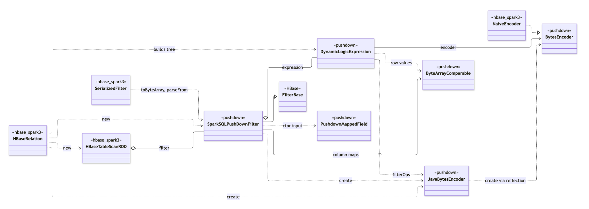
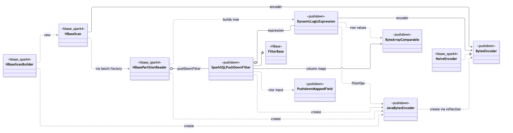
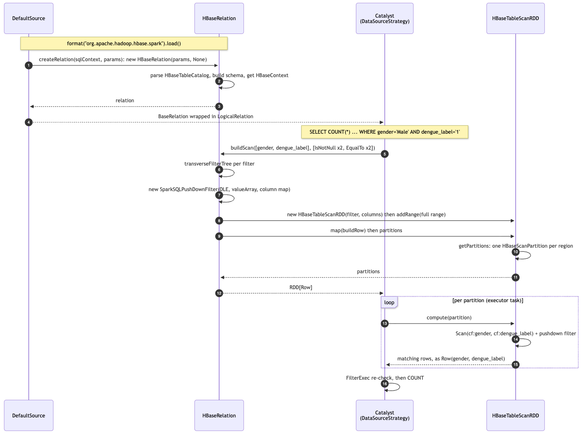
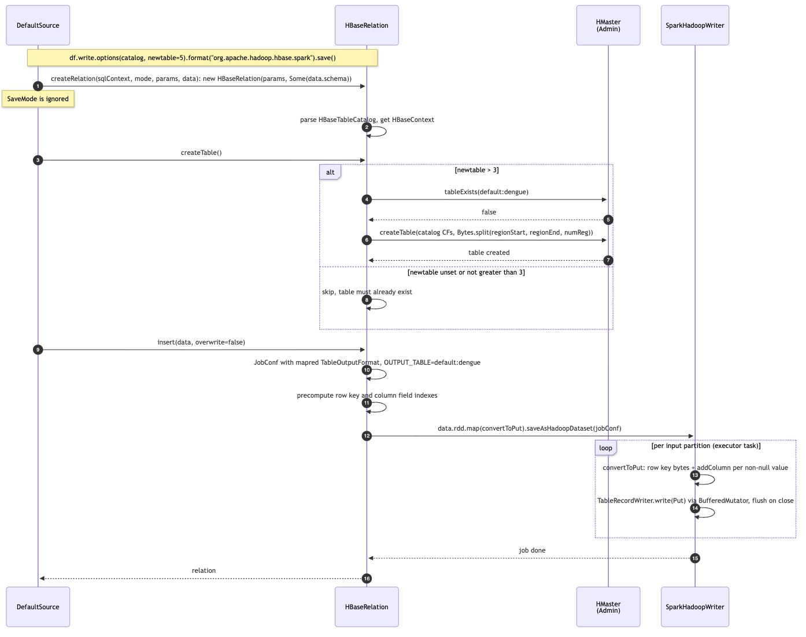
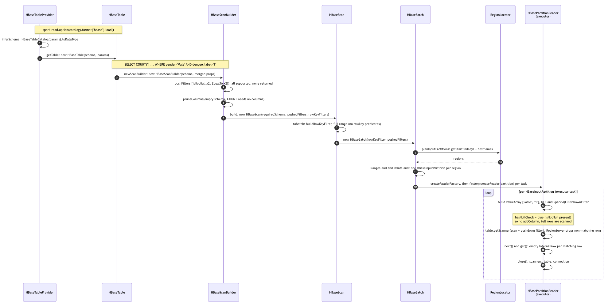
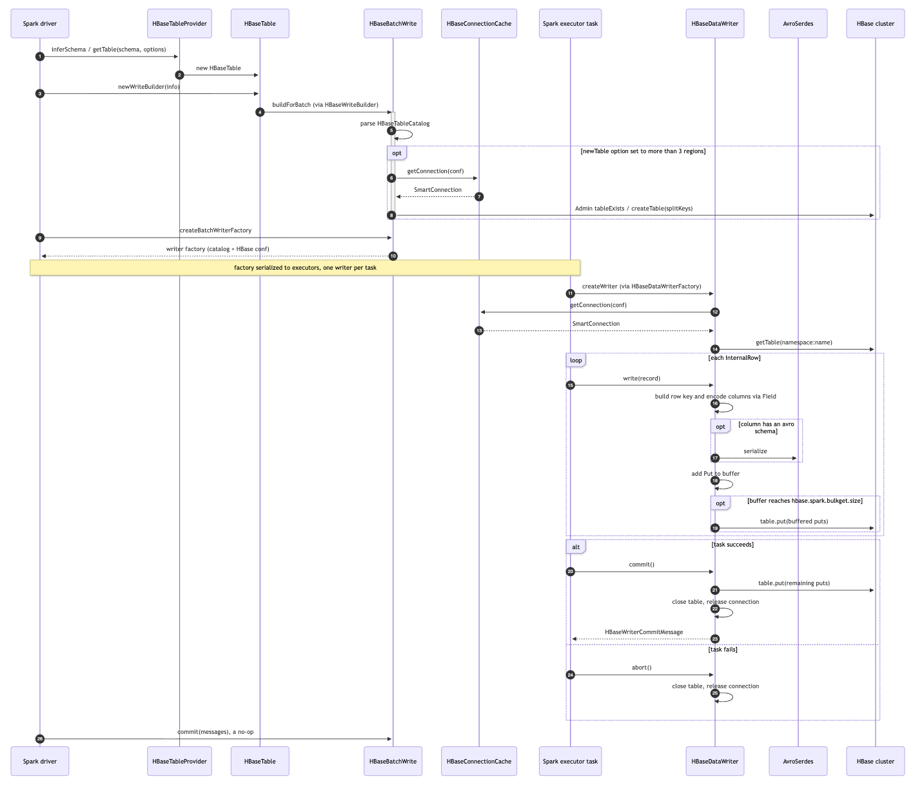
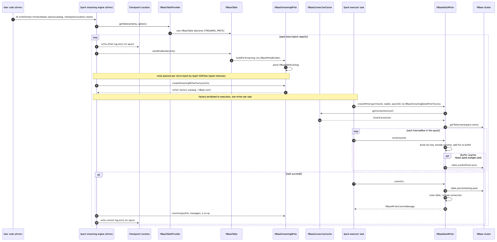

<!---
Licensed to the Apache Software Foundation (ASF) under one
or more contributor license agreements.  See the NOTICE file
distributed with this work for additional information
regarding copyright ownership.  The ASF licenses this file
to you under the Apache License, Version 2.0 (the
"License"); you may not use this file except in compliance
with the License.  You may obtain a copy of the License at

    http://www.apache.org/licenses/LICENSE-2.0

Unless required by applicable law or agreed to in writing, software
distributed under the License is distributed on an "AS IS" BASIS,
WITHOUT WARRANTIES OR CONDITIONS OF ANY KIND, either express or implied.
See the License for the specific language governing permissions and
limitations under the License.
-->

# HBase Connectors Spark4 Design Doc

## Context

Currently, Apache HBase offers a spark integration through the hbase-connectors extra dependency. The hbase-connectors is maintained as a separate library, with its own repo and release cycles, shipped independently from the core HBase. At the moment, it defines modules for both Kafka and Spark integration, and at the moment, spark 3 is the only supported version. This document defines the strategy for implementing an additional Spark 4 compatible module, whilst keeping the existing Spark 3 module for backward compatibility.

## Dependencies

Spark 4 module requires spark 4, which in turn relies on JDK17 and scala 2.13 as minimal versions. HBase version should stay in as the 2.6.x. Spark 3 is based on scala 2.12 and doesn’t work with scala 2.13. There are other transitive dependencies changes between the two modules for json4s-jackson, jackson-databind, guava and zookeeper.

## Scope

1. Redefine modules structure: create a new spark4 main module with a separate maven build profile for spark4, which default maven build still building the spark3 module only. Move java pushdown filters and related util scala classes on a submodule of original spark3 module that can be re-used in the spark4 build (no code duplication here).

2. Refactor pushdown filter module to become independent of spark 3 / scala 2.12 specific versions.

3. Port HBaseContext from spark3 module to spark4 module: HBaseContext is the main facade for read/write operations. RDD reads and bulk put/get/delete. Most code from spark3 can be duplicated here, apart from streaming, as spark3 uses the deprecated DStream API.

4. Port spark3 module bulkload functionality to spark4 module. This involves bringing the bulkLoad/bulkLoadThinRows functions into spark4 HBaseContext, as well as any helper class and types, such as BulkLoadPartitioner, KeyFamilyQualifier, etc.

5. Implement SparkSQL support in the spark4 module using the DataSource V2 API. The spark3 module uses the deprecated DataSource V1 API (RelationProvider, BaseRelation, PrunedFilteredScan). Spark4 module should use the modern DataSource V2 API, which provides better performance (columnar reads, push-down at the connector level) and a cleaner contract.

6. Add spark4 compatible streaming functionality. The spark3 module offers streaming via the deprecated DStream/StreamingContext API (HBaseDStreamFunctions: hbaseBulkPut, hbaseBulkDelete, hbaseBulkGet, hbaseForeachPartition, hbaseMapPartitions). Spark4 module should use DataSource V2 Structured Streaming. Only streaming sink is part of the scope to provide a declarative, catalog based streaming service, instead of the spark3 DStream approach that requires mapping logic from the client application.

## Implementation Details

### Redefined Maven Modules

As explained above, Spark 4 requires Scala 2.13 and Java 17 as minimal, making it binary incompatible with Spark 3, so the Spark 4 code requires a separate module. The pushdown filter related classes can be moved to an individual sub-module of the current spark3 module, then an equivalent module mirrored under the spark 4 module. No code copy is needed on the spark4 pushdown submodule, maven builds can refer to the same source code from spark3 pushdown module, via the add-source goal from mojo build plugin:

```xml
<plugin>
  <groupId>org.codehaus.mojo</groupId>
  <artifactId>build-helper-maven-plugin</artifactId>
  <executions>
    <execution>
      <id>add-shared-pushdown-sources-java</id>
      <phase>validate</phase>
      <goals>
        <goal>add-source</goal>
      </goals>
      <configuration>
        <sources>
          <source>${project.basedir}/../../spark/hbase-spark-pushdown/src/main/java</source>
          <source>${project.basedir}/../../spark/hbase-spark-pushdown/src/main/scala</source>
        </sources>
      </configuration>
    </execution>
  </executions>
</plugin>
```

The target module structure should look like this:

```
|
|---spark
|   |
|   |---hbase-spark
|   |---hbase-spark-it
|   |---hbase-spark-protocol
|   |---hbase-spark-protocol-shaded
|   |---hbase-spark-pushdown
|
|---spark4
    |
    |---hbase-spark4
    |---hbase-spark-pushdown
```

### Pushdown Filter refactoring

This involves moving SparkSQLPushDownFilter, JavaBytesEncoder, ByteArrayComparable and DynamicLogicExpression java/scala classes to the spark/hbase-spark-pushdown module.

The Field type is incompatible between the two scala versions. A new PushdownMappedField interface should be defined to replace references to Field list in the common module, leaving for the specific spark3/spark4 implementations to resolve the column mappings.



*Spark 3 module integration with the new pushdown module*



*Spark 4 module integration with the new pushdown module*

### SparkSQL with the DataSource V2 API

The spark3 module uses the deprecated DataSource V1 API (RelationProvider, BaseRelation, PrunedFilteredScan). For spark4, we'll implement the modern DataSource V2 API, which provides better performance (columnar reads, push-down at the connector level) and a cleaner contract.

#### Spark 3 DS V1

In Spark 3, the entry point for both reads and writes spark sql operations is the DefaultSource, which implements DS V1 RelationProvider/CreatableRelationProvider.

For a read query, Spark loads DefaultSource as provided in its “format” method, which then creates and returns a HBaseRelation instance, an implementation of DS V1 BaseRelation. It's HBaseRelation's job to create the scan (HBaseTableScanRDD) once spark Catalyst plans the query, including evaluating all filter mappings to be pushed to server side filters. Planning and execution logic is interleaved inside HBaseRelation.

For writes, spark calls DefaultSource.createRelation overloaded implementation for save mode, which creates the HBaseRelation instance and to which the data insertion is delegated. Inside HBaseRelation.insert, the spark job is created, the dataframe data is converted to hbase put(s) and sent to executors.



*Spark 3 DS V1 Read Sequence*



*Spark 3 DS V1 Write Sequence*

#### Spark 4 DS V2

In Spark 4, DS V1 is deprecated, and so is the SQLContext widely used around the HBaseRelation implementation. In the DS V2 model, the entry point is an implementation of TableProvider, here we defined it as HBaseTableProvider. The provider is instantiated by Spark via the format() method and it calls the provider getTable() method to obtain the Table implementation (HBaseTable). As part of the DS V2 Table contract, HBaseTable implements the newScanBuilder/newWriteBuilder.

For reads, the HBaseScanBuilder defines auxiliary methods Spark uses in the query plan stage, like defining what columns should be pruned and translating SQL filters to HBase filters. The HBaseScan produced by the builder is used to generate RowKeyFilters, then it delegates partition planning to HBaseBatch. Based on the row key filters generated previously, HBaseBatch finds out which regions need to be read and map it into HBaseInputPartition instances. Each HBaseInputPartition creates a HBasePartitionReader, which is where the actual hbase scan executes (in parallel, as a spark executor).



*Spark 4 DS V2 Read Sequence*

For writes, HBaseWriteBuilder provides both batch and stream writers. Streaming will be covered in the next section, this section is going to focus on batch writes. Client application creates the spark dataframe with a collection of Row objects and sparkSQL schema definition. HBaseTableProvider is again the entry point to be used by spark via the format() method, which resolves all the way down to HBaseDataWriter. Using the specified schema, it parses the table name and translates the dataframe rows into hbase Put objects, which are processed as a single batched put HBaseTable operation.



*Spark 4 DS V2 Write Sequence*

### Streaming

Spark 4 defines a different streaming model, labeled “Structured Streaming”, whilst Spark 3 DStream is now deprecated. Spark 3 DStream calls HBaseContext stream methods, whose implementation is simply a delegate to DStream.foreachRDD. The mutation needs to be constructed by the client application. In Spark 4, streaming is integrated through DS V2, as a declared capability in HBaseTable, and it follows the catalog based declarative approach, so that data frame columns are mapped to rowkeys/cf/qualifiers and the connector code builds the mutation internally. Most of the batched writes logic is reused through the same HBaseDataWriter class.



*Spark 4 DS V2 Streaming Sequence*
